# Доработки для HyperStack

Дополнения к оболочке [HyperStack](https://github.com/hase9awa/hyprstack-shell) для Hyprland 0.56
(конфиг на Lua): голосовой ввод с локальным распознаванием речи, ночной режим, редактор сочетаний
клавиш, настройки мыши и тачпада, индикатор записи экрана. Всё встраивается в родные настройки
и панели оболочки. Проверено на CachyOS, ноутбук с графикой Intel.

**English:** add-ons for the [HyperStack](https://github.com/hase9awa/hyprstack-shell) Hyprland shell:
local voice dictation (whisper.cpp, Vulkan), night light (hyprsunset) with schedule, keyboard shortcut
editor, mouse & touchpad settings page, screen recording indicator. UI is in Russian and English.
Install: `git clone https://github.com/W1nq-coder/hyprstack-personal-config.git && cd hyprstack-personal-config && ./install.sh`

## Как это выглядит

### Панель задач у любого края экрана

Сверху, снизу, слева или справа: Настройки → Панели → Панель задач → Расположение, или зажать
пустое место панели и перетащить к нужному краю. Сбоку панель вертикальная, меню выезжают вбок.

| Слева | Справа |
|:---:|:---:|
| 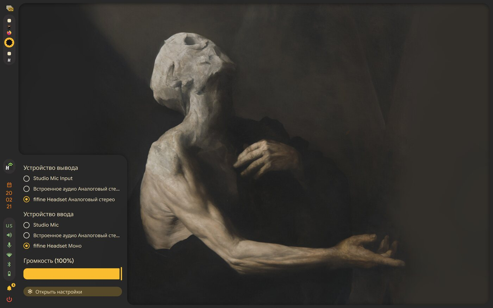 | 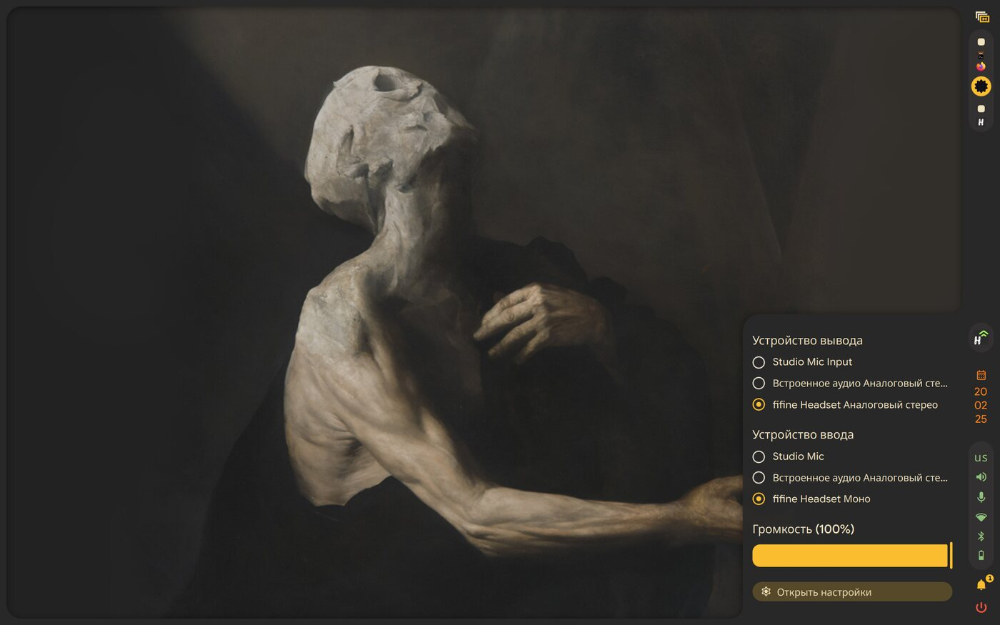 |

| Снизу | Меню рядом с боковой панелью |
|:---:|:---:|
| 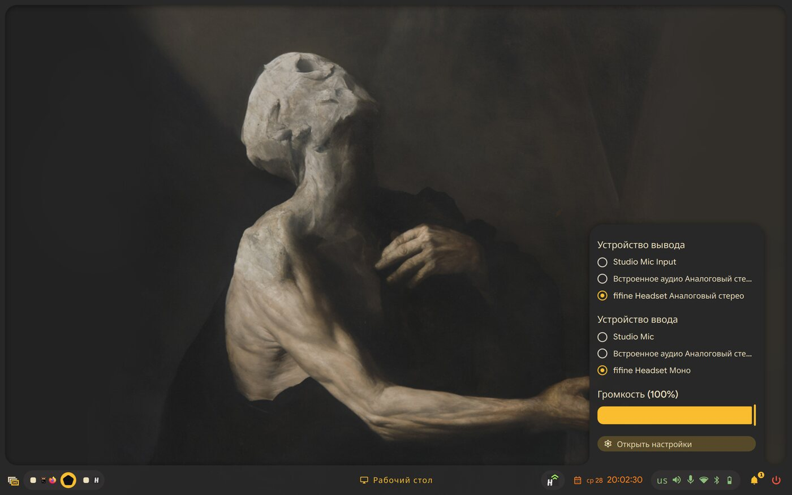 | 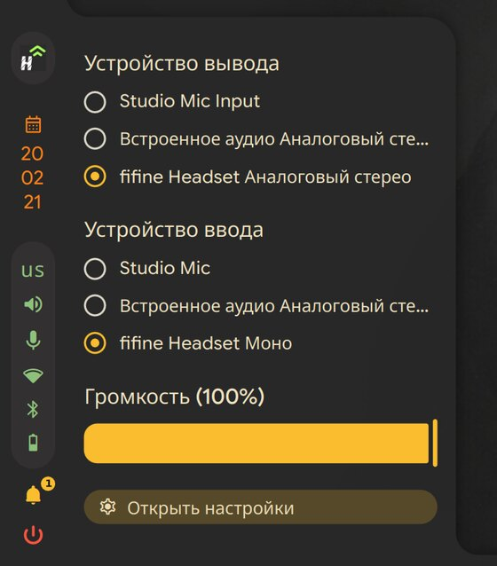 |

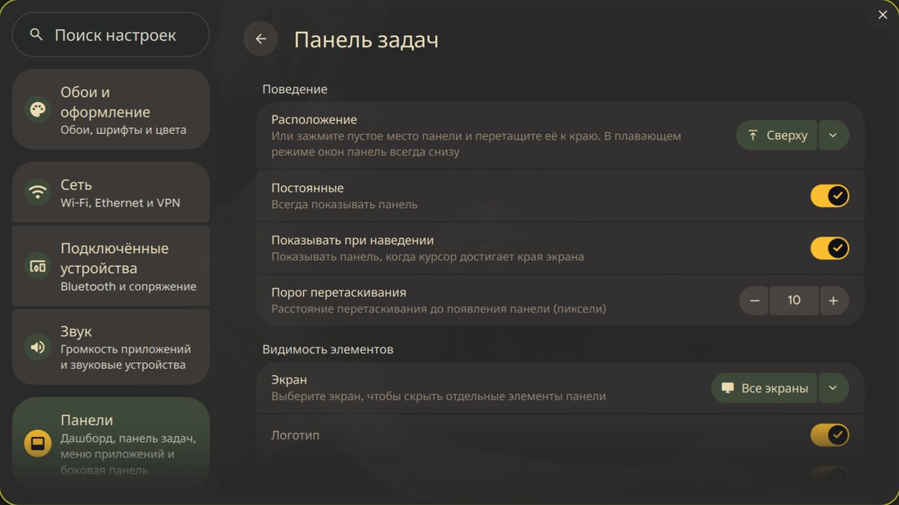

### Дашборд

Всё управление в одном месте: быстрые переключатели, «Не засыпать» и запись экрана теперь на вкладке
«Управление» дашборда, а не в отдельной угловой панели. Дашборд открывается по Super.

| Вкладка «Управление» | Вкладка «Медиа» с текстом песни и «Мне нравится» из плеера |
|:---:|:---:|
| 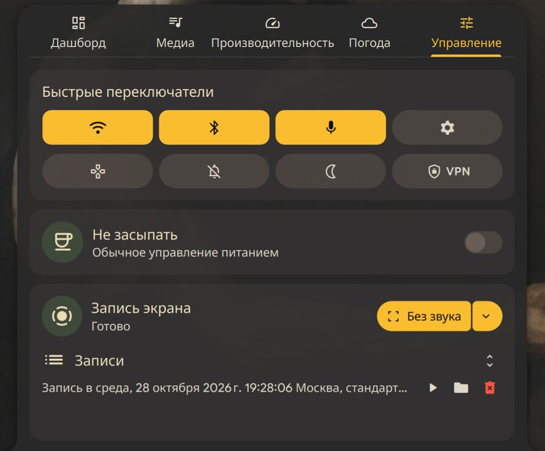 | 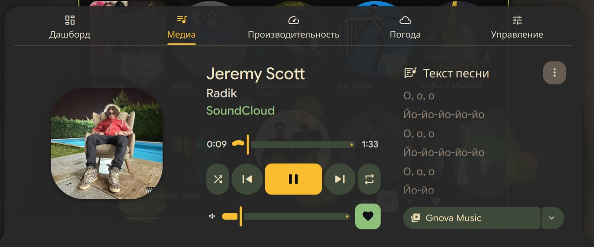 |

### VPN

Отдельное приложение: кнопка VPN в дашборде или Super → «VPN». Подписка добавляется той же ссылкой,
что в Happ. Три вида окна на выбор, весь компьютер через VPN или только прокси, российские сайты без VPN.

| «Кнопка» | «Список» |
|:---:|:---:|
| 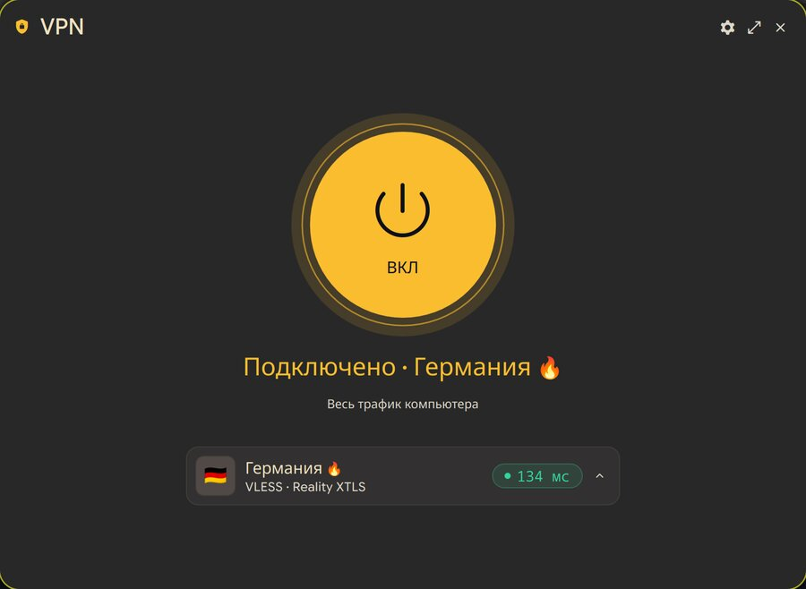 | 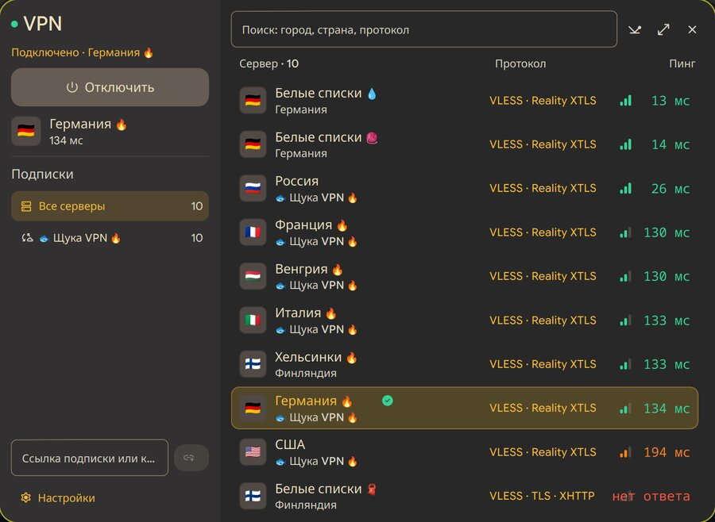 |

| «Плитки» | Настройки VPN |
|:---:|:---:|
| 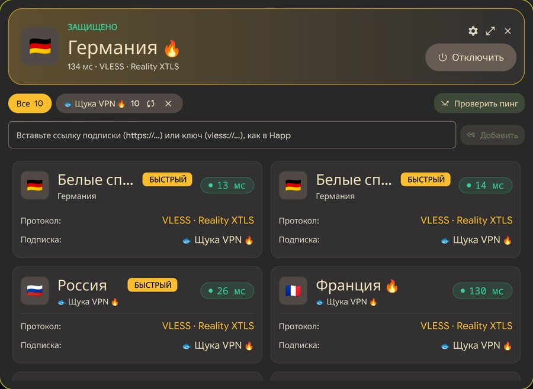 | 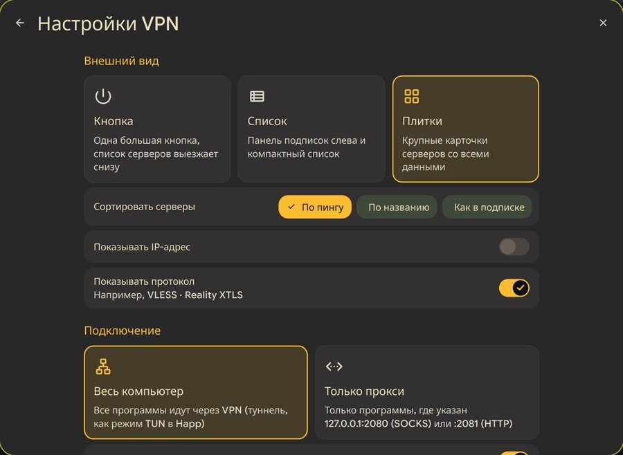 |

### Новые страницы настроек

| Медиа | Мышь и тачпад |
|:---:|:---:|
| 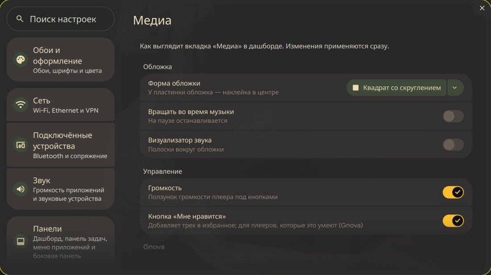 | 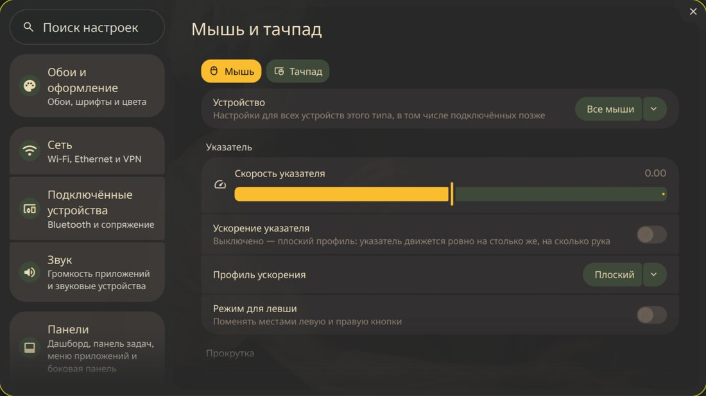 |

| Сочетания клавиш | Голосовой ввод |
|:---:|:---:|
| 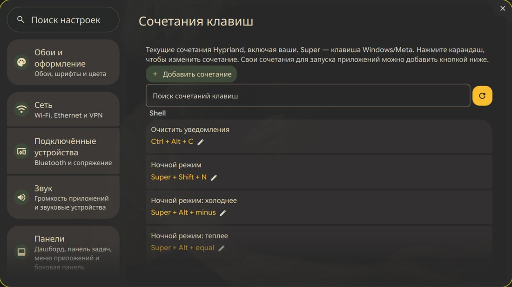 | 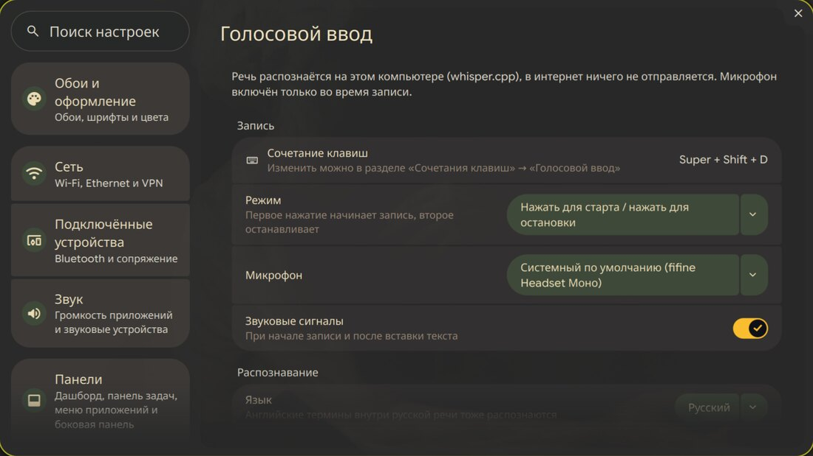 |

| Ночной режим |
|:---:|
| 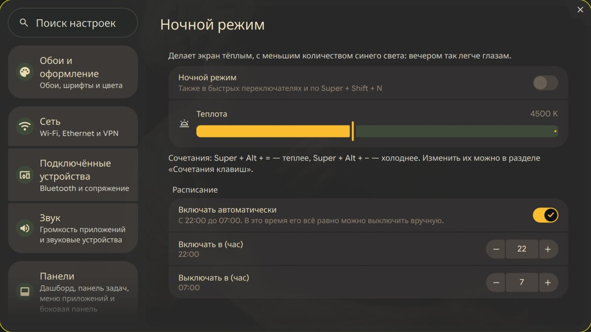 |

## Исправленные ошибки

- **Меню трея и центр уведомлений залезали друг на друга.** Если открыть уведомления, а потом
  меню значка в трее (или наоборот), одна панель оказывалась поверх другой. Теперь открытие одной
  закрывает другую.
- **Сердечко «Мне нравится» в дашборде врало.** При смене трека оно показывало состояние
  предыдущего: трек не в избранном, а сердечко горит. Теперь плеер сообщает новое состояние
  раньше нового названия, а дашборд перепроверяет его при открытии и после смены трека
  (исправлено и в [Gnova](https://github.com/W1nq-coder/gnova-music-download)).
- **Текст песни есть в плеере, а в дашборде «Текст песни не найден».** Плеер и дашборд искали
  текст каждый по-своему. Теперь у плееров с `org.gnova.Player` дашборд берёт тот самый текст,
  что показан в плеере, в том числе исправленный вручную.
- **Текст песни не находился для названий вида «Исполнители — Песня (Official Video)».**
  Перед поиском исполнитель и песня берутся из такого названия, лишние приписки убираются.
- **Дашборд и список приложений выскакивали сами**, стоило мыши дойти до края экрана. Теперь
  они открываются только клавишами (Super и Super+D); вернуть наведение можно в настройках.
- **Подписка VPN не добавлялась целиком из-за одного сервера.** Если в подписке была хоть одна
  неподдерживаемая строка или сервер с ошибкой, отказывала вся подписка. Теперь такие серверы
  пропускаются, а остальные добавляются. Подписка скачивается так, как её просят обычные
  VPN-приложения, поэтому панели VPN отдают список серверов, а не веб-страницу.
- **Оболочка перезапускалась после закрытия окна VPN.** Окно уничтожалось сразу при закрытии, иногда
  прямо во время отрисовки кадра, и графический драйвер падал. Теперь окно при закрытии прячется и
  открывается снова то же самое.
- **Окно VPN нельзя было развернуть на весь экран**: теперь есть кнопка «Развернуть».
- **Окно VPN не открывалось второй раз.** После закрытия окно иногда продолжало считать себя открытым,
  и команда «показать» ничего не делала. Теперь перед показом оно сначала прячется, и открывается всегда.
- **VPN включался, но ни сайты, ни Телеграм не работали.** Причин было несколько:
  - Режим «Весь компьютер» с серверами VLESS (ядро Xray) не запускался: туннель Xray падал с ошибкой
    маршрутизации. Теперь туннель держит sing-box, а к серверу подключается Xray. Так работают
    и протоколы, которых нет в sing-box (например, XHTTP).
  - Сайты с адресами IPv6 (Google, Anthropic и другие) зависали: у большинства VPN-серверов нет IPv6.
    Теперь в режиме туннеля DNS отдаёт только IPv4-адреса, как в Happ и Hiddify.
  - Когда параллельно работал другой VPN (Happ), сайты «без VPN» (российские) не открывались.
    Теперь они всегда идут напрямую через Wi-Fi или кабель.
  - Служба VPN запускала старую копию программы из базовой оболочки, а не личную.
- **Запись экрана тормозила ноутбук**: видео кодировал процессор. Теперь кодирует видеокарта.
- **Страница «Сочетания клавиш» открывалась с задержкой**: теперь сразу, строки создаются в фоне.

## Быстрая установка

Нужен установленный HyperStack. Затем:

```sh
sudo pacman -S --needed whisper-cpp ggml-vulkan wtype wl-clipboard jq ffmpeg curl \
  hyprsunset mpv wf-recorder dolphin satty grim slurp hyprpicker libnotify
# Графика Intel: запись экрана кодируется видеокартой, а не процессором
sudo pacman -S --needed intel-media-driver
git clone https://github.com/W1nq-coder/hyprstack-personal-config.git ~/hyprstack-personal-config
cd ~/hyprstack-personal-config
./install.sh --check   # посмотреть, что изменится
./install.sh
```

`install.sh` не трогает ваши мониторы, сочетания и прочие личные настройки: ваши переменные из
`hypr-vars.lua` он переносит в `vars.lua`, а к `local.lua` только добавляет подключение `extras.lua`.
Заменённые файлы сохраняются в `~/.local/state/hyprstack-personal-backup/<дата>/`.
Для голосового ввода скрипт предложит скачать модель распознавания (~550 МБ).

## Что здесь есть

- **Сочетания клавиш** (Настройки → Сочетания клавиш): изменение любого сочетания карандашиком,
  проверка конфликтов, свои сочетания для запуска приложений и команд.
  Хранятся в `~/.config/hyprstack/keybinds.json`, применяет `keybinds-ui.lua`.
- **Мышь и тачпад** (Настройки → Мышь и тачпад): скорость, ускорение, прокрутка, касания, жесты.
  Хранятся в `~/.config/hyprstack/input.json`, применяет `input-ui.lua`.
- **Кнопка питания** открывает меню сеанса оболочки (бинд в `extras.lua`).
- **Голосовой ввод** — Super+Shift+D. Распознавание локально (whisper.cpp на графике Intel через Vulkan),
  текст вставляется в активное окно. Режимы «нажать/нажать» и «удерживать», язык, модель, микрофон, звуки —
  в Настройки → Голосовой ввод. Скрипт `~/.local/bin/dictation`, настройки `~/.config/hyprstack-dictation/config`.
- **Ночной режим** — тёплый оттенок экрана (hyprsunset). Кнопка с луной в быстрых переключателях,
  Super+Shift+N — вкл/выкл, Super+Alt+= / Super+Alt+− — теплее/холоднее, расписание (по умолчанию 21:00–7:00)
  в Настройки → Ночной режим. Скрипт `~/.local/bin/nightlight`, настройки `~/.config/hyprstack/nightlight.json`.
- **Записи экрана**: плашка «Запись · 0:12» внизу экрана во время записи (клик — остановить),
  кнопка «Папка» открывает Dolphin с выделенным файлом, просмотр в mpv, понятные даты в списке.
  Видео кодирует видеокарта (VAAPI, 60 кадров/с), а не процессор, поэтому ноутбук во время записи
  не тормозит. Если видеокарта недоступна, запись сама переходит на кодирование процессором;
  принудительно — `HYPRSTACK_RECORD_SOFTWARE=1`.
- **Скриншоты как в Omarchy**: Print — выделить область (клик по окну — всё окно) и открыть в Satty
  (Enter — скопировать и сохранить), Shift+Print — сразу в буфер и в файл, Ctrl+Print — весь экран.
  Скрипт `~/.local/bin/screenshot`.
- **Страница «Сочетания клавиш»** открывается сразу: строки списка создаются в фоне.
- **Запись экрана со звуком**: только весь экран, режимы «без звука», «звук системы и микрофон»,
  «только звук системы», «только микрофон» (`hyprstack record --audio-source both|system|mic`).
- **Меню трея и центр уведомлений не перекрываются**: открытие одного закрывает другое.
- **Список приложений** открывается только по Super+D, а не от мыши у нижнего края экрана.
- **Медиа в дашборде** (Настройки → Медиа): форма обложки — волнистая, круг, квадрат со скруглением или
  пластинка; вращение во время музыки, визуализатор, ползунок громкости и кнопка «Мне нравится»
  (для плееров с интерфейсом `org.gnova.Player`, например Gnova). Текст песни ищется и для названий
  вида «Исполнители — Песня (Official Video)». `qs ipc call dashboard openTab 1` — дашборд сразу на вкладке «Медиа».
  У плеера с `org.gnova.Player` дашборд показывает его собственный текст песни и его «Мне нравится»,
  поэтому они всегда совпадают с тем, что в самом плеере.
- **Дашборд только по Super**: не открывается от мыши у края экрана (вернуть: Настройки → Панели → Дашборд).
- **Панель задач у любого края экрана**: сверху, снизу, слева или справа (Настройки → Панели →
  Панель задач → Расположение) или зажать пустое место панели и перетащить к краю. Слева и справа
  панель вертикальная, всплывающие меню выезжают вбок. В плавающем режиме окон панель всегда снизу.
  Настройка — `~/.config/hyprstack/bar.json`.
- **Вкладка «Управление» в дашборде**: быстрые переключатели, «Не засыпать» и запись экрана в одном месте;
  угловая панель утилит справа внизу выключена (вернуть: Настройки → Панели → Утилиты).
- **VPN как отдельное приложение**: кнопка VPN в дашборде или Super → «VPN»; окно можно развернуть
  на весь экран. Вставьте ссылку подписки (`https://…`, та же, что в Happ, или `happ://add/…`) или ключ
  (`vless://`, `vmess://`, `trojan://`, `ss://`, `hysteria2://`, `tuic://`). Подписок может быть несколько:
  у каждой свои «обновить» и «удалить». Три разных вида окна на выбор (шестерёнка → Внешний вид):
  «Кнопка» — одна большая кнопка, список серверов выезжает снизу; «Список» — панель подписок слева и
  компактный список с поиском и полосками сигнала; «Плитки» — карточки с флагом, пингом, IP и протоколом.
  Настройки как в Happ/Hiddify: весь компьютер через VPN (туннель) или только прокси (порт задаётся),
  российские и свои сайты без VPN, DNS (Cloudflare, Google, Quad9, AdGuard с блокировкой рекламы),
  подключение к самому быстрому серверу, обновление подписок и проверка пинга при открытии, сортировка,
  что показывать на карточках. Если работает другой VPN (например, Happ), окно предупреждает об этом.
  Работает на встроенном движке HyperStack (sing-box / Xray); настройки окна — `~/.config/hyprstack/vpn-ui.json`.
- **Настройки на нужной странице**: `qs ipc call settings open <страница> <подстраница>` — номер
  страницы в списке слева с нуля, подстраница или `-1`; например `4 2` — Панели → Панель задач.
- **Яркость и затемнение** (`Brightness.qml`, `brightness.py`, `dimming.lua`, `display-tuning.lua`).

Папка `home/` повторяет домашний каталог, список файлов — `files.txt`.
Личная копия оболочки (`~/.local/share/hyprstack-personal/shell`) содержит только изменённые файлы,
остальное в ней — ссылки на установленную оболочку `~/.local/share/hyprstack/shell`.

## Установка с нуля (моя система целиком)

Команды можно копировать и вставлять по порядку. Основа — CachyOS, при установке выбран Hyprland
(установщик сам ставит драйверы Intel, `hyprland`, `kitty`, `dolphin`, `alacritty`, `btop` и т.п.).

### 1. HyperStack

Зависимости (из [официальной инструкции](https://github.com/hase9awa/hyprstack-shell/blob/main/INSTALL.md#arch)):

```sh
sudo pacman -Syu --needed base-devel git cmake ninja pkgconf gettext \
  hyprland quickshell nlohmann-json qt6-base qt6-declarative qt6-shadertools \
  qt6-svg qt6-imageformats qt6-wayland qt5ct qt6ct libqalculate lm_sensors \
  pixman libdrm libinput systemd-libs wayland libxkbcommon pango cairo \
  python python-pillow kitty firefox fuzzel btop pavucontrol \
  wl-clipboard cliphist grim slurp wf-recorder swappy libnotify \
  brightnessctl networkmanager pipewire pipewire-pulse wireplumber \
  polkit libcap hyprlock hyprpicker xdg-utils xdg-user-dirs libxml2 adwaita-icon-theme dbus \
  glib2 gsettings-desktop-schemas xdg-desktop-portal-gtk
```

Сборка (без `sudo`):

```sh
git clone https://github.com/hase9awa/hyprstack-shell.git ~/hyprstack-shell
cd ~/hyprstack-shell
cmake -S . -B build -G Ninja -DCMAKE_BUILD_TYPE=Release \
  -DCMAKE_INSTALL_PREFIX="$HOME/.local" -DCMAKE_INSTALL_DATADIR="$HOME/.local/share"
cmake --build build --parallel 2
cmake --install build
```

Дальше — шаг «3. Конфигурация» из официальной инструкции `~/hyprstack-shell/INSTALL.md`.

### 2. Пакеты для моих доработок

Голосовой ввод, ночной режим, записи экрана, GitHub:

```sh
sudo pacman -S --needed whisper-cpp ggml-vulkan wtype wl-clipboard jq ffmpeg curl \
  hyprsunset mpv wf-recorder dolphin github-cli satty grim slurp hyprpicker libnotify
# Графика Intel: запись экрана кодируется видеокартой, а не процессором
sudo pacman -S --needed intel-media-driver
```

### 3. Программы, шрифты и инструменты, которые я ставил дополнительно

```sh
sudo pacman -S --needed hyprpaper swaybg ttf-jetbrains-mono-nerd ttf-material-symbols-variable \
  papirus-icon-theme qt6ct xcb-util-cursor archlinux-xdg-menu file-roller \
  firefox firefox-i18n-ru discord telegram-desktop \
  neovim yazi go python-pip nodejs npm rust paru yay
```

Из AUR:

```sh
yay -S --needed visual-studio-code-bin yandex-music incy-bin
```

Вручную:
- **Happ** — пакет `Happ.linux.x64.pkg.tar.zst` с сайта Happ: `sudo pacman -U ./Happ.linux.x64.pkg.tar.zst`;
- **AppImage-программы** (deckcraft, effectcraft, filmcraft, gridcraft, lightcraft, pdfcraft, photocraft,
  wordcraft) — скачать в `~/Applications`.

### 4. Модель распознавания речи (~550 МБ)

```sh
mkdir -p ~/.local/share/whisper-models
curl -L -o ~/.local/share/whisper-models/ggml-large-v3-turbo-q5_0.bin \
  https://huggingface.co/ggerganov/whisper.cpp/resolve/main/ggml-large-v3-turbo-q5_0.bin
```

### 5. Кнопка питания открывает меню вместо выключения

```sh
sudo mkdir -p /etc/systemd/logind.conf.d
printf '[Login]\nHandlePowerKey=ignore\n' | sudo tee /etc/systemd/logind.conf.d/50-power-key.conf
```

Действует после перезагрузки.

### 6. kitty: вставка голосового текста напрямую

Добавить в `~/.config/kitty/kitty.conf` и открыть kitty заново:

```
allow_remote_control socket-only
listen_on unix:${XDG_RUNTIME_DIR}/kitty-{kitty_pid}.sock
```

### 7. Доработки и мои личные настройки

```sh
git clone https://github.com/W1nq-coder/hyprstack-personal-config.git ~/hyprstack-personal-config
cd ~/hyprstack-personal-config
./install.sh --personal
```

`--personal` ставит и мои личные настройки (мониторы, переменные, сочетания, автозапуск —
строки с `~` в `files.txt`) поверх имеющихся. Без него ставятся только сами доработки.

## После обновления или переустановки HyperStack

```sh
cd ~/hyprstack-personal-config
git pull
./install.sh --check               # посмотреть, что изменится (ничего не трогает)
./install.sh                       # у себя: ./install.sh --personal
```

`install.sh`:
1. проверяет пакеты и предлагает доустановить недостающие
   (`whisper-cpp ggml-vulkan wtype wl-clipboard jq ffmpeg hyprsunset mpv wf-recorder dolphin satty` и др.);
2. восстанавливает личную копию оболочки: подключает новые файлы из обновления, убирает битые ссылки;
3. предупреждает, если обновление изменило оригиналы файлов, которые заменены своими версиями
   (тогда эти файлы, возможно, нужно перенести на новую версию);
4. раскладывает файлы (личные настройки — только с `--personal`); отличающиеся прежние версии сохраняет в
   `~/.local/state/hyprstack-personal-backup/<дата>/`;
5. добавляет в `shell.json` кнопку ночного режима и Dolphin для записей экрана;
6. предлагает скачать модель распознавания речи (~550 МБ), если её нет;
7. перезагружает Hyprland и оболочку. Если оболочка с доработками не запустилась,
   возвращает прежние файлы и запускает стандартную оболочку, чтобы не остаться без панели.

Не хранится в репозитории (install.sh подскажет, если нужно):
- модель whisper `~/.local/share/whisper-models/ggml-large-v3-turbo-q5_0.bin`;
- `/etc/systemd/logind.conf.d/50-power-key.conf` с `HandlePowerKey=ignore` (нужен sudo);
- две строки удалённого управления в `~/.config/kitty/kitty.conf` (для вставки голосового текста в kitty).

## Сохранить новые изменения в репозиторий

```sh
cd ~/hyprstack-personal-config
./collect.sh          # копирует текущие версии файлов из files.txt в home/
git add -A && git commit -m "Описание изменений" && git push
```

Новый файл сначала добавьте строкой в `files.txt`.

## Откат

- Вернуть файлы как были до `install.sh`: скопировать их из `~/.local/state/hyprstack-personal-backup/<дата>/` в `~`.
- Запустить стандартную оболочку без доработок: удалить
  `~/.config/systemd/user/hyprstack.service.d/20-personal-shell.conf` и
  `~/.config/systemd/user/hyprstack-session.service.d/10-personal-shell.conf`, затем
  `systemctl --user daemon-reload && systemctl --user restart hyprstack.service`.
- Отключить голосовой ввод, ночной режим или бинд кнопки питания: удалить соответствующий блок
  в `~/.config/hyprstack/extras.lua` (или строку с `extras.lua` в `local.lua` — тогда все три)
  и выполнить `hyprctl reload`; для ночного режима ещё
  `nightlight off && systemctl --user disable --now hyprstack-nightlight-schedule.timer`.

## Лицензия

GPL-3.0, как и у [HyperStack](https://github.com/hase9awa/hyprstack-shell): часть файлов —
изменённые файлы этой оболочки.
